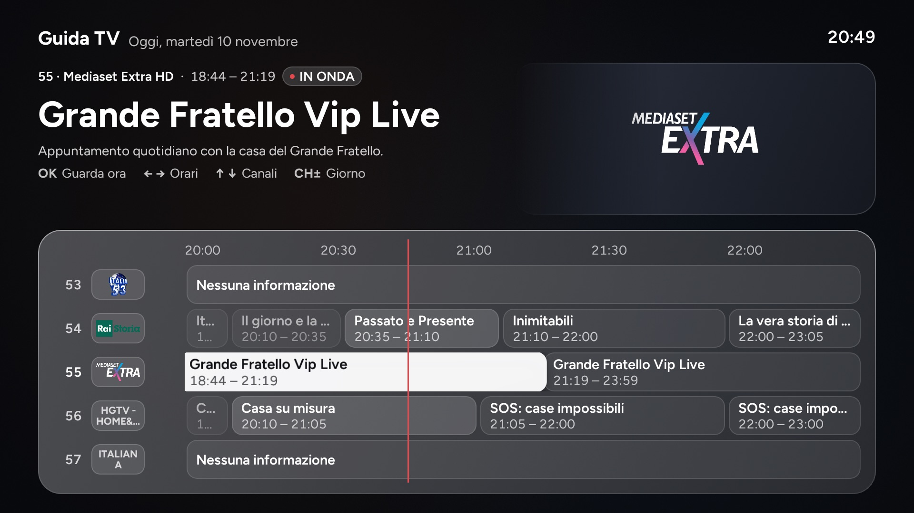
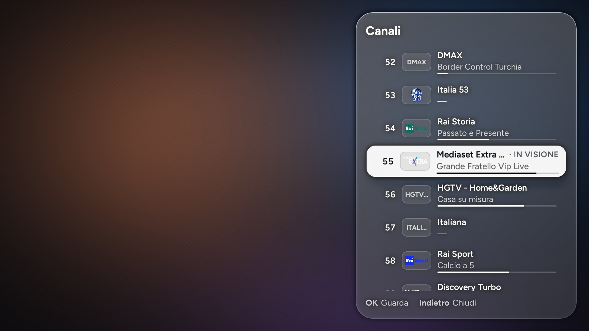
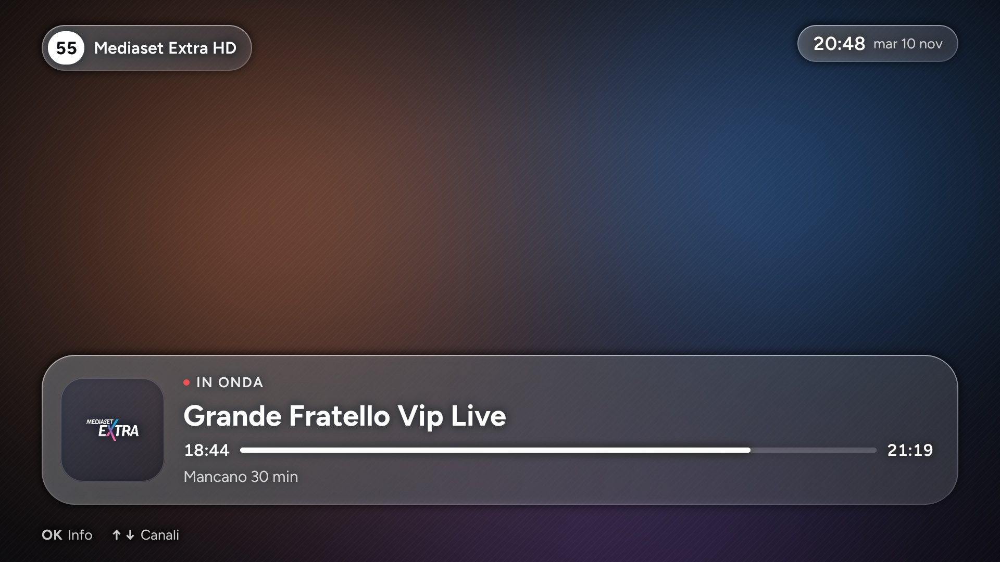
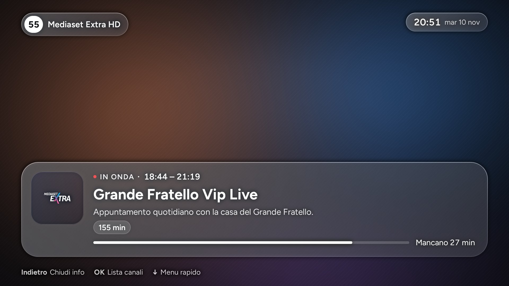
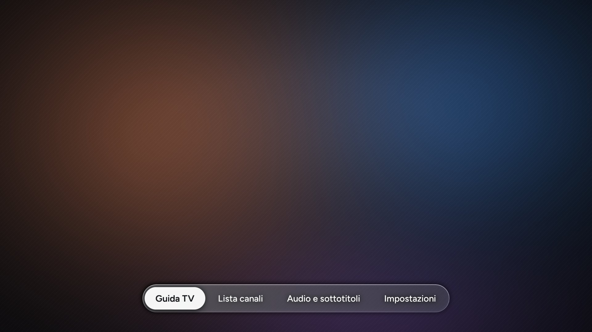
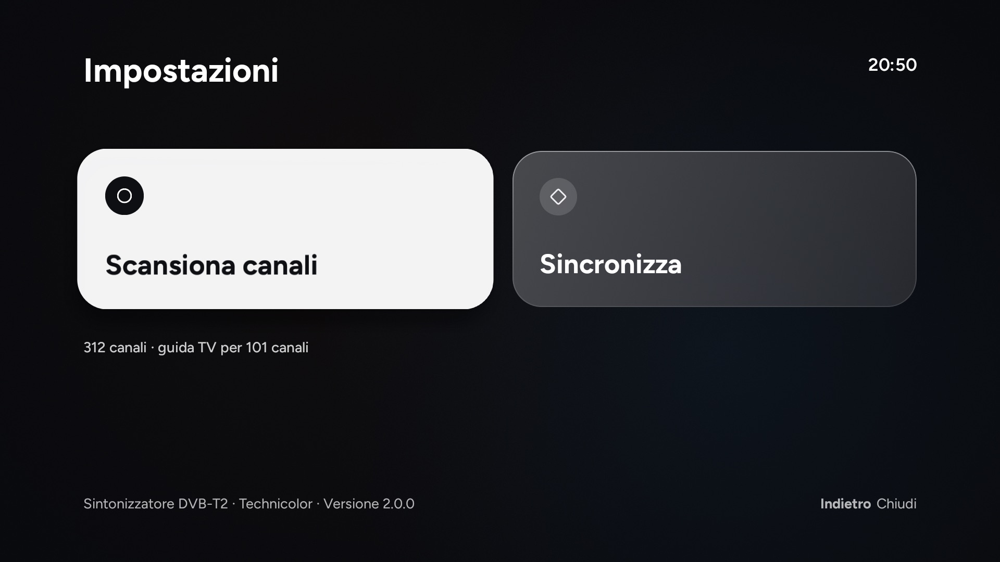

# Canali TV (DTT Live)

Live TV app for Italian digital terrestrial (DVB-T/T2) channels on the TIM Box (Technicolor `uzw4010tim`,
Android 8, no root). Kotlin + Jetpack Compose; it plays through the Android TV Input Framework (`TvView`) on the
box's own Technicolor tuner. Package `it.mdv.dttchannels`, launcher name **Canali TV**, version 2.0.0.

It can replace the TIM app for live TV, for example on a box debloated with
[cleanyourtv](https://github.com/Gathin23/cleanyourtv), whose launcher can map the remote's TV button to it
(`app_keys`: `KEYCODE_TV:it.mdv.dttchannels/.MainActivity`).

## Screenshots

| | |
|---|---|
|  |  |
| TV guide (Guida TV) | Channel list |
|  |  |
| Channel OSD | Programme info |
|  |  |
| Quick menu | Settings |

Taken on the box in the debug preview mode, which draws the screens without tuning. Where the live picture goes,
the OSD, info, channel list and quick menu shots have an ambient backdrop added afterwards, in place of the video.

## How it fits together

```
TIM Box                                     Raspberry Pi (companion/, see companion/README.md)
┌────────────────────────────────┐          ┌──────────────────────────────────────────┐
│ Canali TV (it.mdv.dttchannels) │  HTTP    │ dtt_sync.py (systemd: dtt-sync), :8765   │
│  TvView → Technicolor tuner    │◀────────▶│  channel list: adb backup of TvProvider  │
│  ContentProvider for other apps│          │  EPG: XMLTV (epgshare01 IT1), every 4 h  │
└────────────────────────────────┘          │  logos: tv-logo/tv-logos (italy)         │
             ▲  adb (5555)                  │  scan helper: toggles timvision.telemetry│
             └──────────────────────────────┴──────────────────────────────────────────┘
```

On this firmware an ordinary app cannot read the tuner's channels from Android's TV provider, but it can tune a
channel URI. So the Pi exports the channel table over ADB, adds guide data and logos, and the app downloads
the result.

## Using it

| Key | Live screen |
|---|---|
| CH+ / CH− (also Page Up/Down) | Next / previous channel. A burst of presses tunes only once, when they stop. |
| Digits | Go to that LCN: after the third digit, on OK, or 2 s after the last digit |
| OK | Show the OSD; again for programme info; from info, the channel list. While browsing, OK tunes the browsed channel. |
| ↑ / ↓ with the OSD up | Browse channels without tuning (↑ = next number); ↓ in info opens the quick menu |
| ← / → with the OSD up | Previous / next programme on that channel |
| Any arrow, nothing on screen | Quick menu: Guida TV, Lista canali, Audio e sottotitoli, Impostazioni |
| Guide / Menu | Open or close the TV guide / the quick menu |
| Info | Show or hide the OSD |
| Last channel | Previous channel |
| Back | Closes what is open; from a radio channel, back to TV; otherwise leaves the app |

**Timeshift ("differita").** ▶❚❚ or OK pauses and resumes. ◀◀ ▶▶ (or ← → on the timeshift bar) jump 10 s;
Stop or the TIM remote's blue circle key goes back to live. The Technicolor tuner keeps no rolling buffer: it
starts recording at the first pause, so you can go back only as far as that pause, and "live" means a re-tune.
Leaving the app while delayed asks for a second Back, because the recording is dropped.

**Settings (Impostazioni).**
- *Sincronizza*: asks the Pi for a fresh channel list and guide, then opens the guide.
- *Scansiona canali*: runs the box's own channel scan, then syncs. Technicolor's scan app crashes while
  `timvision.telemetry` is disabled, so the app first calls the Pi's `POST /scan/prepare` (the Pi enables it over
  ADB), opens the scan, and on return calls `POST /scan/done` (disabled again; the Pi also does that by itself after
  30 min).

"Nessun segnale" means no signal on that channel, or a channel list that is stale after a scan: sync again.

## Build & install

```sh
JAVA_HOME=/Library/Java/JavaVirtualMachines/temurin-17.jdk/Contents/Home ./gradlew assembleDebug
adb -s <box ip>:5555 install -r app/build/outputs/apk/debug/app-debug.apk
```

The companion's address is built into the app. Put it in `local.properties` (not committed) before building:

```properties
companion.url=http://192.168.1.50:8765
```

or pass `-PcompanionUrl=http://192.168.1.50:8765` to Gradle. Without either, the app uses
`http://raspberrypi.local:8765`. There is no setting for it in the app, so a new address means a rebuild.

Debug builds only: `adb shell am start -n it.mdv.dttchannels/.MainActivity --ez preview true` draws the UI without
tuning. Live video comes out black in screenshots on this box.

## Permissions and network

- `INTERNET`, with cleartext HTTP allowed: the Pi is reached over plain HTTP on the LAN.
- Channel list, guide and logos come from the Pi. Programme images in the guide are loaded straight from the
  addresses in the XMLTV data, so they come from the internet.
- No account, no analytics.

## Integration for other apps

- Play: action `it.mdv.dttchannels.PLAY`, extra `number` (LCN, String) or `index` (Int).
  Launcher entry: `.MainActivity` (last channel).
- Channel list: `content://it.mdv.dttchannels/channels` (`?number=5` for one LCN).
  Columns: `_id, number, name, type, onid, tsid, sid, input_id, channel_uri, browsable, radio, logo_uri`.
- Broadcast `it.mdv.dttchannels.CHANNELS_UPDATED` after each sync.

## Known limits

- Only on this box: it needs the Technicolor tuner input and the Pi companion.
- The guide covers 6 h back to 48 h ahead and matches channels by name. `companion/overrides.json` fixes the ones
  that don't match.
- EPG and logo sources are free, unofficial aggregators: fine for personal use, with no guarantee of service.
- Fast zapping can crash the box's video decoder, so a burst of CH± presses makes a
  single tune.
